# BÁO CÁO BÀI THI THỰC HÀNH: ỨNG DỤNG QUẢN LÝ SẢN PHẨM
## (PRODUCT MANAGEMENT APP – WEB ADMIN & MOBILE ANDROID)

---

## 1. GIỚI THIỆU ĐỀ TÀI
Dự án "Xây dựng ứng dụng quản lý sản phẩm" phục vụ phân hệ quản trị viên (Admin) trên nền tảng Web và thiết bị di động (Android). Ứng dụng cho phép quản trị viên theo dõi, thêm mới, chỉnh sửa, xóa và tìm kiếm sản phẩm với dữ liệu thực tế được lưu trữ tập trung tại cơ sở dữ liệu MongoDB.

---

## 2. MỤC TIÊU
- Xây dựng hệ thống hoàn chỉnh tách biệt Frontend và Backend thông qua RESTful API.
- **Web Admin**: Đăng nhập quản trị, xem danh sách, thêm, sửa, xóa, tìm kiếm sản phẩm, dashboard thống kê kho, hồ sơ cửa hàng tuỳ chỉnh, giao diện responsive hiện đại.
- **Mobile Android**: Hiển thị sản phẩm, xem chi tiết, thêm sản phẩm và chọn/tải ảnh trực tiếp từ thư viện hoặc camera thiết bị di động.
- **Cơ sở dữ liệu**: Kết nối MongoDB hiện có (`ProductManagement`), bảo đảm đúng 4 trường dữ liệu (`name`, `price`, `soluong`, `image`) và không có trường thừa.

---

## 3. CÔNG NGHỆ SỬ DỤNG
- **Backend:** 
  - Node.js v22.20.0
  - Express.js
  - Mongoose
  - Multer (xử lý upload ảnh multipart/form-data)
  - CORS (chia sẻ tài nguyên giữa Web và Mobile)
  - dotenv (quản lý biến môi trường)
  - bcryptjs (mã hóa mật khẩu)
  - jsonwebtoken (xác thực quyền truy cập JWT)
- **Frontend:** 
  - React Native
  - Expo SDK 58 (tương thích phiên bản Expo Go mới nhất trên Android)
  - Expo Router v4
  - React Native Web
  - TypeScript
  - Axios (gọi RESTful API)
  - Expo Image Picker (chọn và upload ảnh từ thư viện / camera)
- **Cơ sở dữ liệu:** 
  - MongoDB Server (Local Windows, Port 27017)
  - Database: `ProductManagement`
  - Collection: `products`

---

## 4. KIẾN TRÚC FRONTEND – BACKEND
Hệ thống tuân thủ kiến trúc phân tầng độc lập:
```
┌─────────────────────────────────┐       ┌─────────────────────────────────┐
│     React Native Web (Admin)    │       │   Mobile Android (Expo App)     │
│   http://localhost:8081 (Web)   │       │   Mạng LAN: 192.168.1.5         │
└────────────────┬────────────────┘       └────────────────┬────────────────┘
                 │                                         │
                 │ RESTful API (JSON & Multipart)          │
                 ▼                                         ▼
┌───────────────────────────────────────────────────────────────────────────┐
│                    BACKEND REST API (Express.js)                          │
│                    Lắng nghe tại cổng 5000                                │
│       Auth (JWT)  │  Upload (Multer)  │  Products CRUD                    │
└─────────────────────────────────────┬─────────────────────────────────────┘
                                      │ Mongoose Connection
                                      ▼
┌───────────────────────────────────────────────────────────────────────────┐
│                    MONGODB DATABASE (Windows Local)                       │
│    URI: mongodb://localhost:27017/ProductManagement                        │
│    Collection: products (Chỉ 4 trường: name, price, soluong, image)       │
└───────────────────────────────────────────────────────────────────────────┘
```

---

## 5. CẤU TRÚC THƯ MỤC
```
ProductManagement/
│
├── backend/
│   ├── config/
│   │   └── database.js         # Kết nối MongoDB ProductManagement
│   ├── models/
│   │   └── Product.js          # Mongoose Schema (4 trường, không __v)
│   ├── controllers/
│   │   ├── authController.js   # Đăng nhập Admin & cấp phát JWT
│   │   └── productController.js# CRUD sản phẩm, tìm kiếm, sắp xếp
│   ├── routes/
│   │   ├── authRoutes.js       # /api/auth
│   │   ├── productRoutes.js    # /api/products
│   │   └── uploadRoutes.js     # /api/upload
│   ├── middleware/
│   │   └── authMiddleware.js   # Xác thực quyền Admin Bearer JWT
│   ├── uploads/                # Lưu trữ file ảnh vật lý (.gitkeep)
│   ├── .env                    # Biến môi trường Backend (đã đưa vào .gitignore)
│   ├── .env.example            # Mẫu cấu hình bảo mật
│   ├── package.json            # Dependencies Backend
│   └── server.js               # Entry point khởi chạy máy chủ Express
│
├── frontend/
│   ├── app/
│   │   ├── _layout.tsx         # Định tuyến gốc Expo Router
│   │   ├── index.tsx           # Kiểm tra phiên đăng nhập và chuyển hướng
│   │   ├── login.tsx           # Màn hình đăng nhập Web Admin (bảo mật)
│   │   ├── admin/
│   │   │   ├── dashboard.tsx   # Bảng điều khiển thống kê kho hàng
│   │   │   └── products.tsx    # Quản lý sản phẩm (Bảng, Thêm, Sửa, Xóa, Chi tiết)
│   │   └── mobile/
│   │       ├── index.tsx       # Màn hình chính Mobile Android (Danh sách SP)
│   │       ├── add.tsx         # Màn hình Thêm sản phẩm Mobile (Expo Image Picker)
│   │       └── detail/
│   │           └── [id].tsx    # Màn hình Chi tiết sản phẩm Mobile (Ảnh Hero)
│   ├── components/
│   │   ├── Navbar.tsx          # Thanh điều hướng responsive (Mobile & Desktop Web)
│   │   │                       # Tích hợp Hồ Sơ Cửa Hàng & tuỳ chỉnh logo
│   │   ├── StatCard.tsx        # Thẻ thống kê số liệu kho hàng (Dashboard)
│   │   ├── ProductFormModal.tsx# Hộp thoại Thêm / Sửa sản phẩm kèm Upload ảnh
│   │   └── DeleteConfirmModal.tsx # Hộp thoại xác nhận xóa an toàn
│   ├── services/
│   │   ├── api.ts              # Cấu hình Axios Interceptors
│   │   ├── authService.ts      # Gọi API đăng nhập và lưu JWT token
│   │   ├── productService.ts   # Gọi API CRUD sản phẩm, upload, export JSON
│   │   └── storage.ts          # Lưu trữ token & logo cửa hàng đa nền tảng
│   ├── types/
│   │   └── product.ts          # Định nghĩa kiểu dữ liệu TypeScript
│   ├── constants/
│   │   └── api.ts              # Cấu hình IP và URL Backend Web/Mobile
│   ├── assets/                 # Biểu tượng và hình ảnh giao diện
│   ├── app.json                # Cấu hình Expo
│   ├── tsconfig.json           # Cấu hình TypeScript
│   └── package.json            # Dependencies Frontend
│
├── database/
│   └── products.json           # File dữ liệu chuẩn bị nộp bài
│
├── report/
│   ├── BAO_CAO.md              # Báo cáo chi tiết đề tài
│   └── [ảnh minh hoạ]         # Ảnh chụp màn hình các chức năng
│
├── README.md                   # Hướng dẫn tổng quan dự án
├── .gitignore                  # Loại trừ node_modules, .env, .expo
└── products.json               # File dữ liệu gốc được bảo vệ
```

---

## 6. THIẾT KẾ CƠ SỞ DỮ LIỆU
- **Database:** `ProductManagement`
- **Collection:** `products`
- **Cấu trúc Document:**
  - `_id`: ObjectId (mặc định của MongoDB)
  - `name`: String (Tên sản phẩm)
  - `price`: Number (Đơn giá)
  - `soluong`: Number (Số lượng tồn kho)
  - `image`: String (URL hoặc đường dẫn ảnh upload)
- **Quy tắc nghiêm ngặt:** Cấu hình `{ collection: 'products', versionKey: false, timestamps: false }` đảm bảo không phát sinh `__v`, không có `createdAt`/`updatedAt`, không thêm trường nghiệp vụ ngoài quy định.
- **5 sản phẩm mẫu:**

| STT | Tên sản phẩm      | Đơn giá (VND) | Số lượng |
|-----|-------------------|--------------|---------|
| 1   | iPhone 16         | 22.000.000   | 10      |
| 2   | Samsung Galaxy S25| 20.000.000   | 15      |
| 3   | MacBook Air M4    | 27.000.000   | 8       |
| 4   | AirPods 4         | 3.500.000    | 20      |
| 5   | iPad Air M3       | 16.000.000   | 12      |

---

## 7. CÁC CHỨC NĂNG ĐÃ XÂY DỰNG
### Phân hệ Backend:
1. **Quản lý sản phẩm (RESTful API):**
   - `GET /api/products`: Lấy danh sách sản phẩm (có tìm kiếm `?search=` và sắp xếp `?sort=`).
   - `GET /api/products/:id`: Lấy chi tiết một sản phẩm.
   - `POST /api/products`: Thêm sản phẩm mới (chỉ nhận đúng 4 trường, chặn trường lạ, bảo vệ bằng JWT).
   - `PUT /api/products/:id`: Cập nhật sản phẩm theo ID (chỉ cập nhật 4 trường, bảo vệ bằng JWT).
   - `DELETE /api/products/:id`: Xóa sản phẩm theo ID (bảo vệ bằng JWT).
   - `POST /api/products/export`: Xuất dữ liệu đồng bộ ra file `database/products.json`.
2. **Upload hình ảnh:**
   - `POST /api/upload`: Nhận file ảnh qua Multer, kiểm tra định dạng và kích thước (tối đa 5MB), bảo vệ bằng JWT Authentication, lưu vào `backend/uploads/` và trả về đường dẫn URL.
   - Phục vụ file tĩnh tại endpoint `/uploads/:filename`.
3. **Xác thực Admin:**
   - `POST /api/auth/login`: Xác thực tài khoản quản trị, sinh mã JWT token thời hạn 24 giờ.
   - `GET /api/auth/me`: Kiểm tra thông tin phiên làm việc.

### Phân hệ Web Admin:
1. **Đăng nhập Admin (`/login`):** Giao diện đăng nhập tối giản, bảo mật, không hiển thị thông tin tài khoản mặc định, lưu JWT vào AsyncStorage, tự động kiểm tra phiên và điều hướng.
2. **Dashboard (`/admin/dashboard`):** 4 thẻ thống kê (StatCard): Tổng sản phẩm, Tổng tồn kho, Tổng giá trị kho, Mặt hàng cao cấp nhất. Bảng danh sách sản phẩm preview. Navbar desktop đầy đủ với tabs điều hướng.
3. **Quản lý sản phẩm (`/admin/products`):**
   - Bảng danh sách chuyên nghiệp: STT, Hình ảnh, Tên + ID, Đơn giá VND, Badge tồn kho, nút Sửa & Xóa.
   - Thanh tìm kiếm thời gian thực theo tên.
   - 5 bộ lọc sắp xếp: Tất cả, Giá thấp↗, Giá cao↘, Kho nhiều, Kho ít.
   - Modal **Thêm sản phẩm**: Form tải ảnh lên hoặc dán URL, nhập tên, đơn giá, số lượng.
   - Modal **Chỉnh sửa sản phẩm**: Form điền sẵn thông tin hiện tại, hỗ trợ đổi ảnh.
   - Modal **Xác nhận xóa**: Hiển thị tên sản phẩm cần xóa, nút Hủy / Xác nhận màu đỏ.
   - Modal **Chi tiết sản phẩm** (khi nhấn vào dòng sản phẩm trên mobile): Ảnh lớn + Số lượng tồn kho + Mã ID MongoDB + nút Chỉnh sửa & Xóa.
4. **Hồ sơ cửa hàng (nhấn vào logo/tiêu đề):** Hiển thị tên & logo cửa hàng; tải logo mới từ máy tính/điện thoại; chọn 4 logo preset có sẵn; thông tin quản trị viên & số mặt hàng; nút Đăng xuất nhanh.

### Phân hệ Mobile Android:
1. **Danh sách sản phẩm (`/mobile`):**
   - Giao diện thẻ (Card) chuẩn di động: Ảnh sản phẩm, tên, đơn giá VND nổi bật, huy hiệu số lượng tồn kho.
   - Thanh tìm kiếm lọc thời gian thực.
   - Kéo để làm mới (Pull-to-refresh).
   - Nút hành động nổi (FAB `➕`) dẫn đến màn hình thêm sản phẩm.
2. **Chi tiết sản phẩm (`/mobile/detail/[id]`):**
   - Ảnh sản phẩm kích thước lớn (Hero image).
   - Hiển thị đầy đủ: Tên sản phẩm, đơn giá VND, số lượng tồn kho, mã `_id` MongoDB.
   - Thanh nút cố định đáy màn hình: Chỉnh sửa sản phẩm & Xóa.
3. **Thêm sản phẩm Mobile (`/mobile/add`):**
   - Form nhập: Tên, Đơn giá, Số lượng.
   - Tích hợp `expo-image-picker`: Chọn ảnh từ Thư viện / Chụp từ Camera.
   - Tự động upload ảnh lên Backend Multer và lưu vào MongoDB với đúng 4 trường được phép.

---

## 8. HƯỚNG DẪN CÀI ĐẶT THƯ VIỆN
```bash
# Backend
cd backend
npm install

# Frontend
cd frontend
npm install
```

---

## 9. HƯỚNG DẪN CHẠY BACKEND
Tại thư mục `backend/`:
```bash
npm run dev
```
- Server chạy tại: `http://localhost:5000` (hoặc qua IP mạng LAN `http://192.168.1.5:5000`).

---

## 10. HƯỚNG DẪN CHẠY WEB ADMIN
Tại thư mục `frontend/`:
```bash
npx expo start --web
```
- Mở trình duyệt tại: `http://localhost:8081`
- Tài khoản đăng nhập Admin: `admin` / `admin123`

---

## 11. HƯỚNG DẪN CHẠY MOBILE ANDROID

### Cách 1: Chạy trên điện thoại Android thật (Khuyên dùng)
1. Đảm bảo máy tính và điện thoại Android kết nối **chung một mạng Wi-Fi**.
2. Địa chỉ IPv4 của máy tính trên mạng Wi-Fi: **`192.168.1.5`** (đã cấu hình sẵn trong `frontend/constants/api.ts`).
3. Khởi chạy Expo:
   ```bash
   cd frontend
   npx expo start
   ```
4. Mở ứng dụng **Expo Go** trên điện thoại Android, quét mã QR hoặc chọn **"Enter URL manually"** và nhập `exp://192.168.1.5:8081` để khởi chạy ứng dụng.

### Cách 2: Chạy trên Android Emulator (Máy ảo Android)
Máy tính đã có sẵn AVD: `Medium_Phone_API_35`.
1. Khởi chạy máy ảo Android từ Android Studio hoặc qua dòng lệnh:
   ```bash
   C:\Users\admin\AppData\Local\Android\Sdk\emulator\emulator.exe -avd Medium_Phone_API_35
   ```
2. Tại terminal đang chạy Expo (`npx expo start`), nhấn phím **`a`** trên bàn phím để mở ứng dụng trực tiếp trên Android Emulator.

---

## 12. HÌNH ẢNH MINH HỌA CÁC CHỨC NĂNG

### 12.1. Phân hệ Web Admin – Giao diện Desktop

**Đăng nhập Web Admin (giao diện bảo mật, không hiển thị thông tin tài khoản mặc định):**
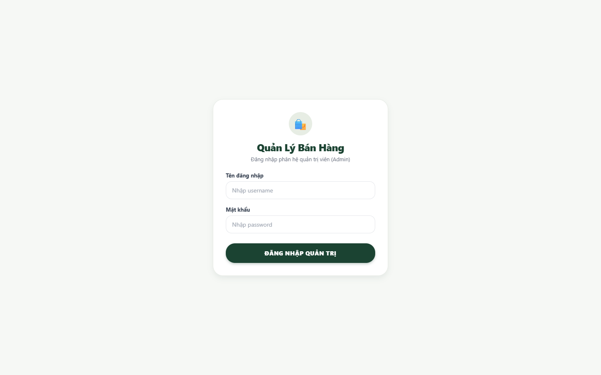

**Dashboard – Báo cáo hoạt động kho hàng (4 thẻ StatCard + bảng sản phẩm):**
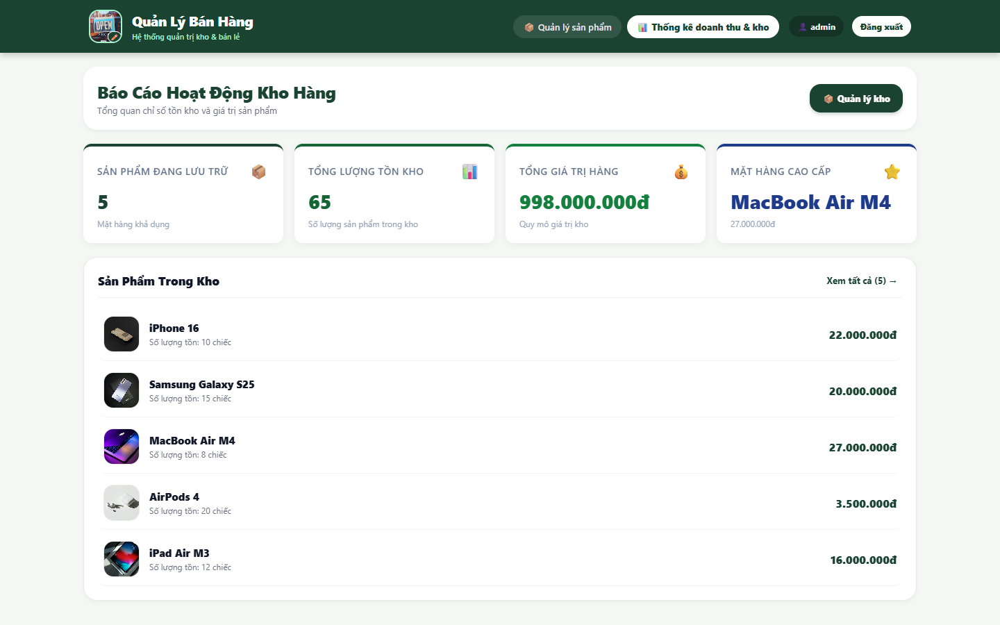

**Quản lý sản phẩm – Bảng danh sách chuyên nghiệp Desktop (5 sản phẩm, logo, ID, giá VND, badge tồn kho):**
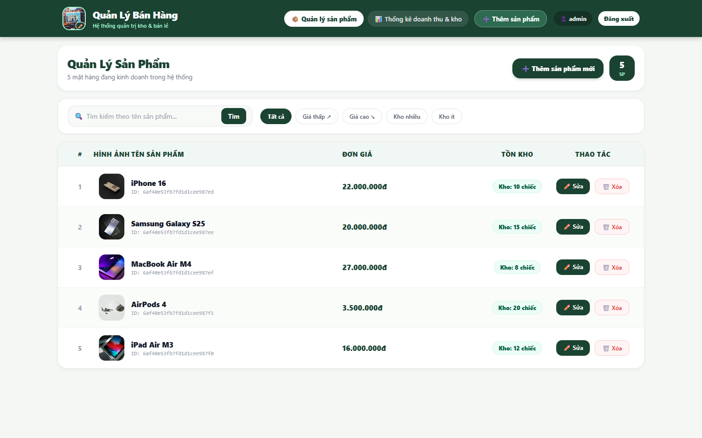

**Hồ sơ cửa hàng – Nhấn logo/tiêu đề để mở (tuỳ chỉnh logo, xem thông tin quản trị viên):**
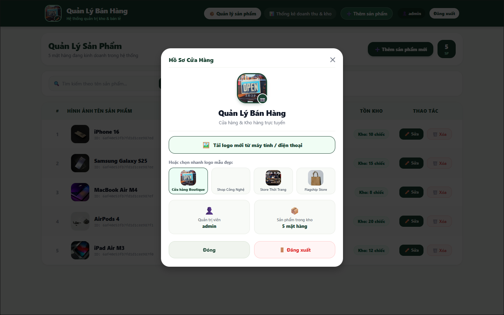

**Hộp thoại Thêm sản phẩm mới (form tải ảnh + nhập tên, giá, số lượng):**
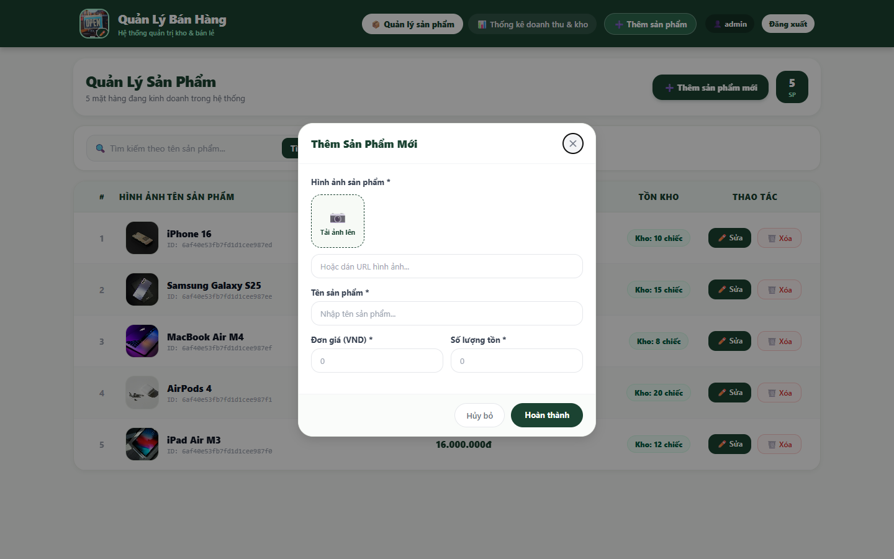

**Hộp thoại Chỉnh sửa sản phẩm (form điền sẵn thông tin hiện tại):**
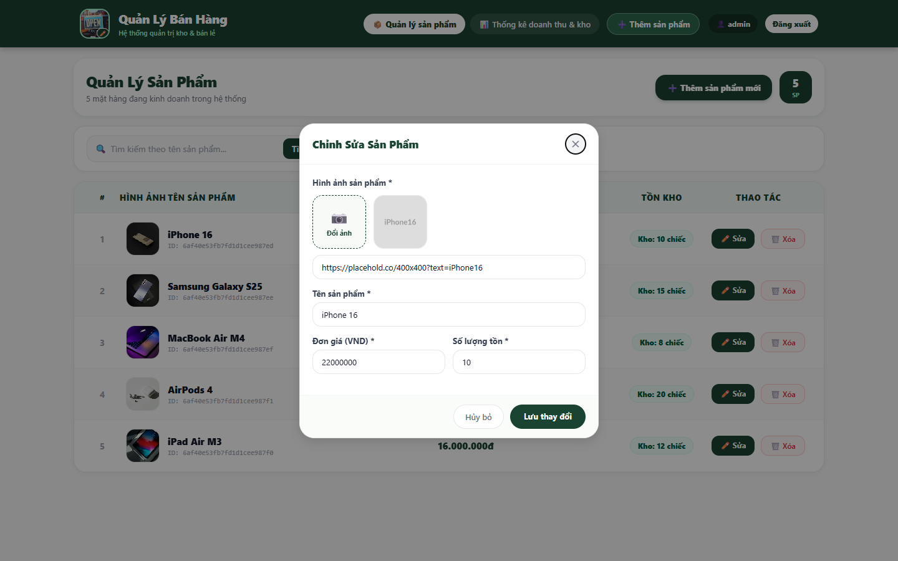

**Hộp thoại Xác nhận Xóa (hiển thị tên sản phẩm, nút Xác nhận màu đỏ):**
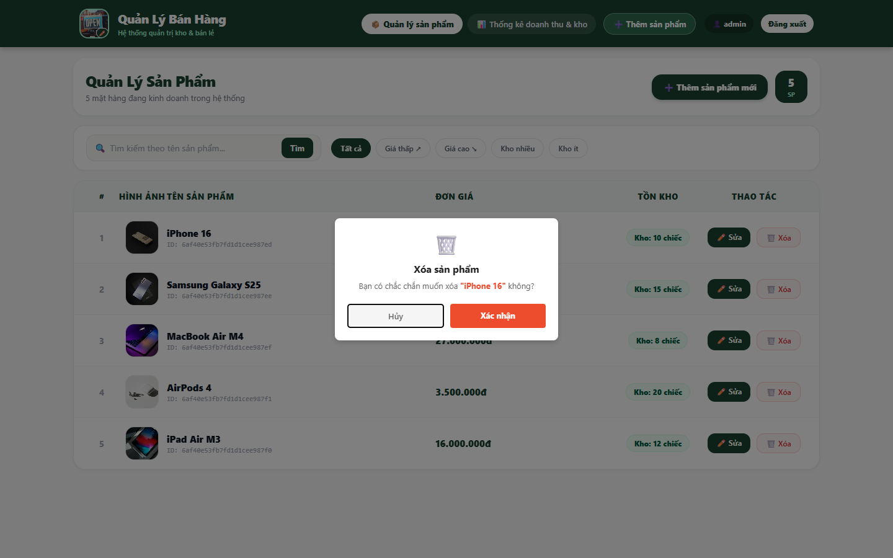

---

### 12.2. Phân hệ Web Admin – Giao diện Mobile Responsive

**Danh sách sản phẩm Mobile Web (card + search + filter + FAB ➕):**
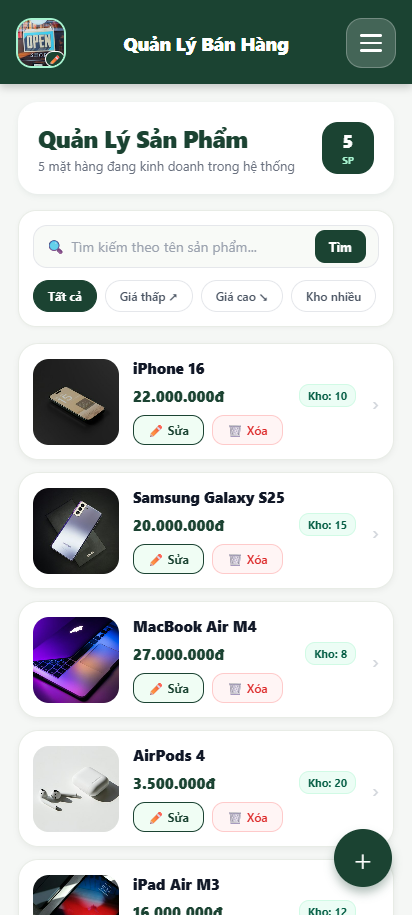

---

### 12.3. Phân hệ Mobile Android

**Màn hình danh sách sản phẩm Mobile Android (card, giá VND, tồn kho):**


**Chi tiết sản phẩm (Hero image, số lượng tồn kho, mã ID, thanh nút đáy):**
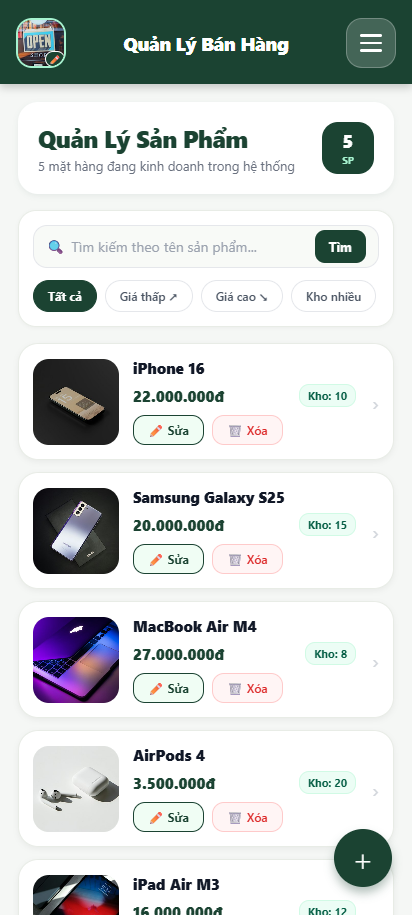

**Thêm sản phẩm Mobile (form + Expo Image Picker chọn ảnh / chụp camera):**
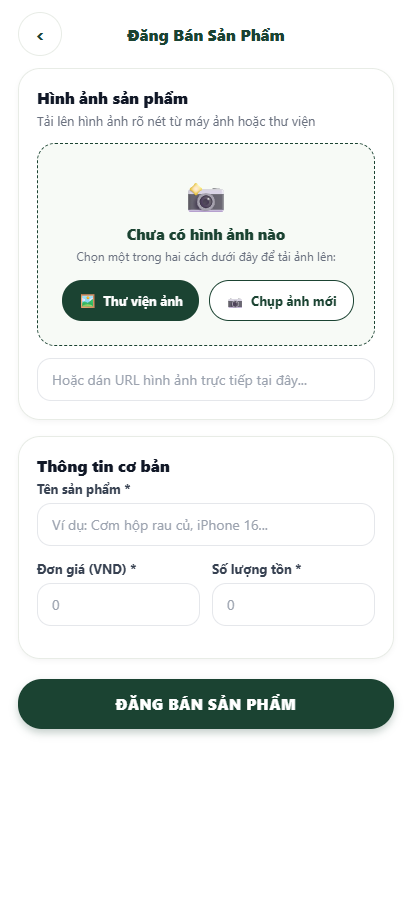

---

### 12.4. Cơ sở dữ liệu MongoDB

**Kiểm tra Collection `products` – 5 sản phẩm chuẩn 4 trường (không có `__v` hay trường thừa):**
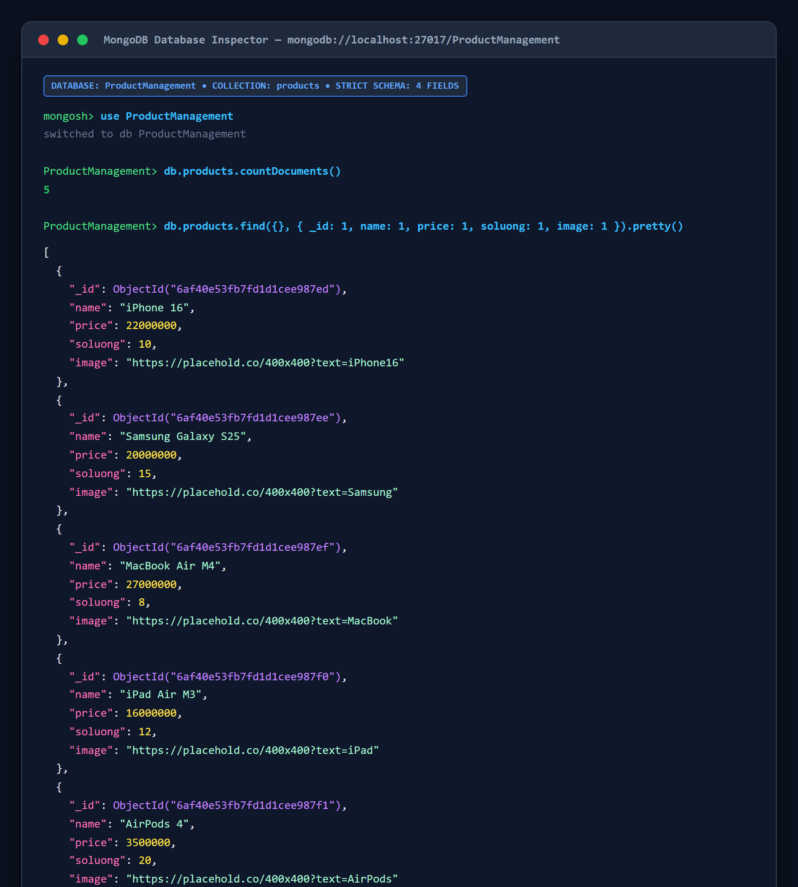

---

### 12.5. Kiểm thử CRUD

**Kiểm thử Tạo sản phẩm (Create):**
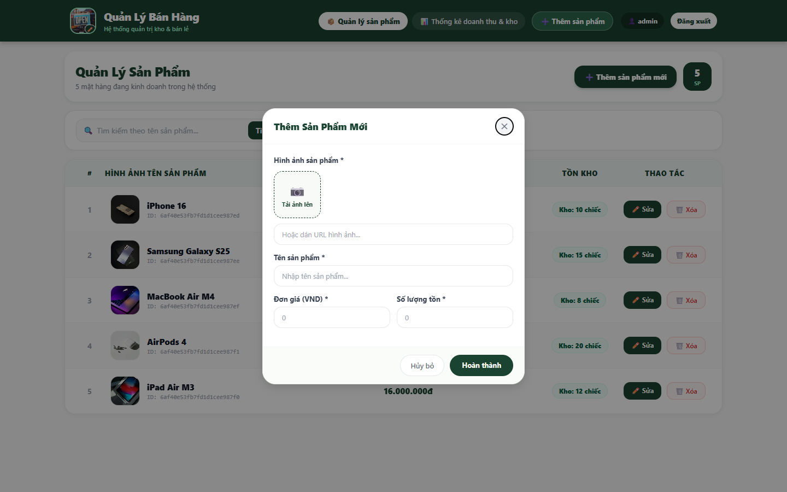

**Kiểm thử Cập nhật sản phẩm (Update):**
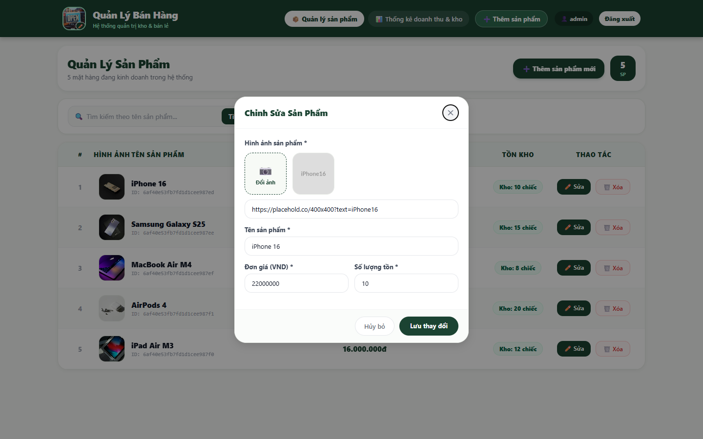

**Kiểm thử Xóa sản phẩm (Delete):**


---

## 13. KẾT LUẬN
Dự án đã hoàn thành trọn vẹn cả phân hệ Web Admin và Mobile Android kết nối chung cơ sở dữ liệu MongoDB, đáp ứng tuyệt đối toàn bộ yêu cầu của đề bài thi.

**Điểm nổi bật của giao diện đã hoàn thiện:**
- Navbar Web desktop đầy đủ: Logo cửa hàng tuỳ chỉnh, tabs điều hướng, nút Thêm sản phẩm, pill user Admin, nút Đăng xuất.
- Màn hình Mobile: Header compact với logo + tiêu đề + nút hamburger ☰, không hiển thị chữ "Admin" hay phân hệ thừa.
- Hồ sơ cửa hàng: Modal popup khi nhấn logo/tiêu đề, hiển thị thông tin cửa hàng, hỗ trợ upload & chọn logo preset.
- Modal chi tiết sản phẩm (web/mobile): Ảnh hero lớn, thông tin tồn kho, mã ID MongoDB, thanh nút Chỉnh sửa & Xóa.
- Bảo mật: Màn hình đăng nhập không hiển thị thông tin tài khoản mặc định; mọi API sửa/xóa đều yêu cầu JWT.
- Dữ liệu MongoDB: Đúng 5 sản phẩm, đúng 4 trường, không có `__v` hay timestamp thừa.
